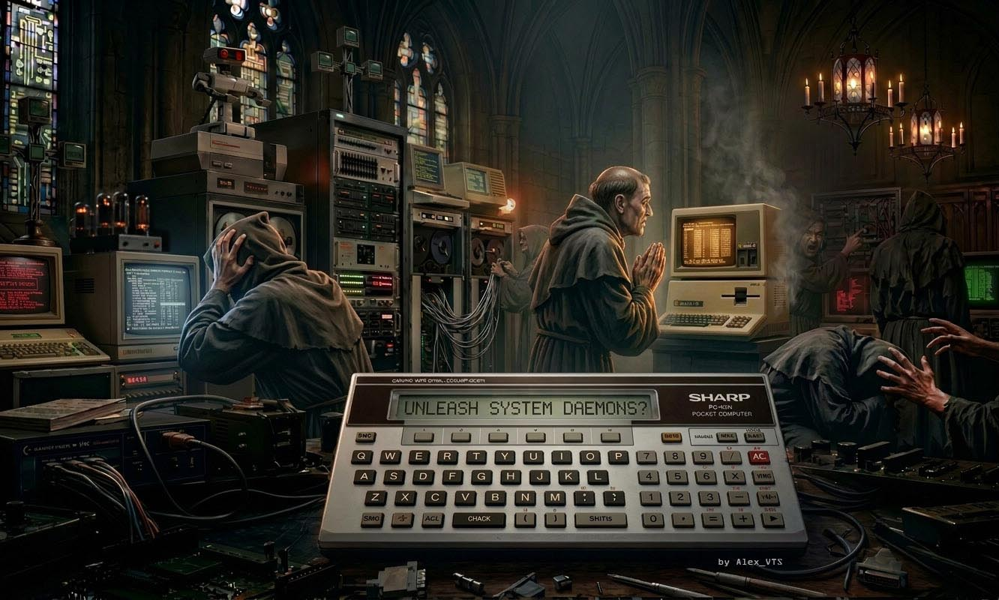

# BASTIONS OF RETROCOMPUTING

A strategy game in BASIC for the Sharp PC-1500, PC-1500A and Tandy PC-2.

## The game

**The CATHODIC CHURCH (CC)** - a fictional organisation with a **profound interest in vintage computing** - maintains ten places across Europe, called Bastions of Vintage IT, from Lourdes to the Vatican (numbered 0-9). In these sites of retro computing the Cathodic Church keeps its vintage and NOS treasures: old hardware from IBM, HP, Apple, Commodore, Atari, Sharp, Casio, NEC and others. They are revered and heavily protected, and no outsider is let in. The security systems of every bastion are run by TECH PRIESTS, who also guard its tokens and its retro stuff. Your task is to conquer the bastions by breaking through the Tech Priests' defences. You lead a team of highly skilled programmers: Hackers and Gurus, and you throw Daemons and Trojans at the bastions. Conquer all ten places to win the war; if you lose all your people, the Cathodic Church wins.

Nobody gets hurt in this war: it is fought with code. A hacker or guru is eliminated when the Tech Priests defeat their solution, their code or their system, and leaves the battlefield in one piece for a long relaxation and a complete rewrite; Tech Priests fall the same way, when their systems crash, and spend the rest of the war in the Cathodic Church's retreat centre, waiting for the main spiritual help desk.

- **Hackers** attack with their own code and methods: unholy code that finds every flaw in the Tech Priests' systems, malicious scripts, self-replicating worms, infinite loops. They also throw the Daemons and Trojans you take into the fight, and they stand in the front line: the Tech Priests strike them first. A sixteenth of the Tech Priests of a conquered place defect to you as new Hackers; you can also hire them.
- **Gurus** fight in every fight, all of them, at the end of every round. Their weapon is Dependency Hell: they tangle the Tech Priests' systems in conflicting library versions, circular dependencies, broken links and corrupted files and data, until nothing can be built or started any more - and the power of Gurus is monstrous. They stay with you for the next fights, but Tech Priests hunt them, above all when they are far outnumbered. Sometimes some Gurus join you after a won fight.
- **Daemons** (cheap: a hit eliminates one Tech Priest) and **Trojans** (a hit eliminates three) are weapons: your Hackers throw a sixth of what you took in every round, as long as at least one of them still fights.

 **KEYS**
- **F – Fight:** choose a place; the game shows how many Tech Priests defend it and what it is **fearful of**
  (`FEARFUL OF DAEMONS`, `TROJANS`, `HACKERS` or `GURUS`): there the hits of that kind count three times, while all the other hits are weaker (divided by 6 at Daemons-fear, 2 at Trojans-fear, 3 at Hackers-fear, 6 at Gurus-fear, where the Tech Priests also strike Hackers twice as hard).
  Then decide how many Hackers, Daemons and Trojans to take (your Gurus always fight), and fight or
  retreat. A fight lasts about five rounds: `HACKERS launch worms!`, `Attack of Trojans!`,
  `Unleashing Daemons!`, `GURUS set Dependency Hell`; when the last fighting Hackers fall, the
  weapons are not thrown any more (`NO HACKERS LEFT!`). At a place fearful of Gurus bring Gurus. From the second round on, while you have fewer fighters than the
  Tech Priests, `S` appears on the round screen (`ROUND3:CC 120 vs YOU 45  S`): press **S to surrender**:
  you keep your fighters and the weapons not thrown, and the place keeps only the Tech Priests it has left.
  Otherwise the fight goes on to the last fighter: when all your fighters fall, it is `NO ONE LEFT!` and
  `GAME OVER` - even if some Hackers stayed at home.
  A conquered place gives you its tokens, retro stuff, Daemons and Trojans (never the kind it fears),
  its own retro treasure, new Hackers and, with a chance of one half, some Gurus.
- **B – Buy:** Hackers (104 tokens), Gurus (520), Daemons (10) and Trojans (30).
- **S – Sell:** retro stuff, Daemons (5 tokens) and Trojans (15). Retro stuff sells for 60 tokens at the
  start; after every fight its price rises by 0-20, and every sale lowers it by 0-40, but never below 35:
  it slowly rises for a player who sells now and then.
- **T – Tax:** every place you win (or win back) adds three times its tokens to the tax money; T pays it all out (`GOT 345 TOKENS`) and again whatever has been gathered since. The first T also lets your places break free (see below). The tax is where you get the tokens for places 7, 8 and 9.
- **R – Resources** (shown as `RS` in the menu `FIGHT/BUY/SELL/TAX/RS/END?`) and **E – End** (E shows `Y=END`: Y ends the game, any other key brings the menu back).

Every element counts: Hackers carry the fight and throw the weapons, Daemons are cheap, Trojans hit hard, and Gurus do what Hackers and weapons cannot - above all at places fearful of Gurus. Leave any of them out and you win clearly less often.

The first places are easy and every next one is harder. Places 7, 8 and 9 are rich places,
with twice as many Tech Priests and more than twice as many tokens, but not twice as much retro
stuff: what one of them gives you is not enough for the next one. Save tokens and retro stuff
from the first places. Once you have collected the tax for the first time (key T), the Tech Priests
fight back (before that nothing breaks free): from time to time one of your places breaks free and gets back the Tech Priests it had at
the start. Winning it back gives half its tokens and half its retro stuff (no treasure): a chance to
collect a little more for the Vatican (place 9), the richest of all.

Full rules: [instructions_v2.6.pdf](instructions_v2.6.pdf) ([instructions_v2.6.docx](instructions_v2.6.docx)).

## Installation

You need a PC-1500A, or a PC-1500 or PC-2 with a RAM module (CE-151 or larger): the game
needs about 5.9 KB of memory. To load the recording you need the CE-150 (for the PC-2: the
Radio Shack printer/cassette interface).

1. Switch off the computer, insert it into the CE-150 and connect the audio output of a
   computer or player to the EAR jack of the CE-150.
2. Switch on, select PRO mode and type `NEW0` [ENTER], then `CLOAD` [ENTER].
3. Play [bastions-v2.6.wav](bastions-v2.6.wav) (name on the tape: `BASTIONS`,
   about 7 minutes).
4. Select RUN mode and type `RUN` [ENTER].

You can also type in the listing [bastions_of_retrocomputing-v2.6.txt](bastions_of_retrocomputing-v2.6.txt). Leave
out the REM lines: the recording does not contain them either, and with them the program
would not leave enough memory for its variables on a PC-1500A. The place names, treasures and
some messages contain small letters (SML key).

## Older versions

- Version 2.5 (no tax, retro price 110, places break free from place 5) is kept in
  [archive/v2.5](archive/v2.5).
- Version 2.4 (an eighth of the priests defect, no divisors at fearful places) is kept in
  [archive/v2.4](archive/v2.4).
- Version 2.3 (Ghosts with API keys and Hackers with Killer Disks, gold, weak spots) is kept in
  [archive/v2.3](archive/v2.3).
- Version 2.2 (with garrisons, weak spots ×1.5 and lower prices) is kept in
  [archive/v2.2](archive/v2.2).
- Version 2.1 (still called PROFANE ATTACK: Hackers and Ghosts without disks or keys cannot attack,
  K-Disks are stopped by the firewalls in the first round) is kept in [archive/v2.1](archive/v2.1).
- Version 2.0 (the same IT world, without weak spots and garrisons, with stronger gurus) is kept
  in [archive/v2.0](archive/v2.0).

Earlier versions take place in a different setting: religious wars.
- Version 1.7 (the religious war: Satanists with brimstones, mercenaries with inverted crosses,
  jihadists, militants and relics) is kept in [archive/v1.7](archive/v1.7).
- Version 1.6 (first functional version) is kept in [archive/v1.6](archive/v1.6).
