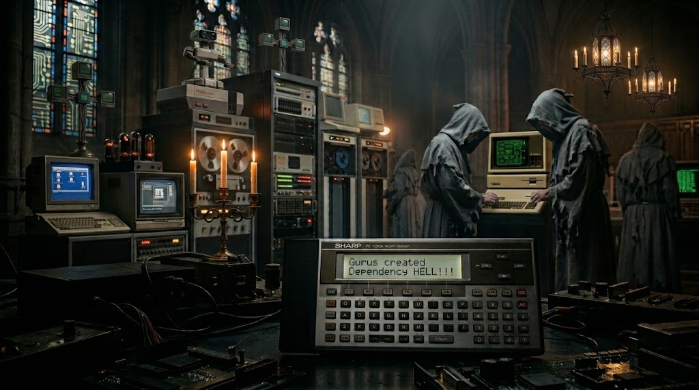

# PROFANE ATTACK

A strategy game in BASIC for the Sharp PC-1500, PC-1500A and Tandy PC-2.

## The game

**The CATHODIC CHURCH (CC)** - a fictional organisation with a **profound interest in vintage computing** - maintains ten places across Europe, called Bastions of Vintage IT, from Lourdes to the Vatican (numbered 0-9). In these sites of retro computing the Cathodic Church keeps its vintage and NOS treasures: old hardware from IBM, HP, Apple, Commodore, Atari, Sharp, Casio, NEC and others. They are revered and heavily protected, and no outsider is let in. The security systems of every bastion are run by TECH PRIESTS, who also guard its gold and its retro stuff. Your task is to conquer the bastions by breaking through the Tech Priests' defences. You lead a team of highly skilled programmers: Ghosts, Hackers and Gurus. Conquer all ten places to win the war; if you lose all your people, the Cathodic Church wins.

Nobody gets hurt in this war: it is fought with code. A hacker, ghost or guru is eliminated when the Tech Priests defeat their solution, their code or their system, and leaves the battlefield in one piece for a long relaxation and a complete rewrite; Tech Priests fall the same way, when their systems crash, and spend the rest of the war in the Cathodic Church's retreat centre, waiting for the main spiritual help desk.

- **Hackers** fight with Killer Drives: HDDs loaded with code that unleashes system daemons, merge conflicts, malicious code, deadlocks, and infinite loops, which drive the Tech-Priests' machines into an infernal overheat or a thermal meltdown (each hacker runs one per round; every drive is used only once).
  Hackers also stand in the front line: the Tech Priests strike them first and reach the ghosts
  only when no hackers are left.

- **Ghosts** silent, brilliant programmers who strike with surgical precision: their sinister, unholy code finds every flaw in the Tech Priests’ systems. They unleash hidden bugs, plagues of self-replicating worms, corrupted servitor firmware, poisoned data-rites, and the dreaded Miracle Exploit — a zero-day opening through which no firewall, no ward, and no machine-spirit can hold. They need API keys to attack (each ghost uses one per round; every key is
  used only once). You cannot hire them: they join you as volunteers when you conquer a place.
  
- **Gurus** fight alone, without Killer Drives or API keys. They strike with a huge,
  meticulously prepared Dependency Hell that paralyses the Tech Priests' systems and inflicts sheer terror among them - and power of Gurus is monstrous. They stay with you for the next fights, but Tech Priests hunt them, above all when they are far outnumbered.

 **KEYS**
- **F – Fight:** choose a place, decide how many Killer Drives (HDDs) and API keys to take, then fight
  or retreat. Every Killer Drive and API key is used only once: in each round each hacker runs
  one drive and each ghost uses one key, until they are all used; those not used come back to
  you after a won fight. The fight goes on round by round until one side has nobody left; at
  most a third of the Tech Priests fall in one round, so it lasts at least three rounds. From
  the second round on, while you have fewer people than the Tech Priests, an S appears on the
  round screen: press **S to surrender**. You keep your people and the unused drives and keys, and
  the place keeps only the Tech Priests it has left, so your next attack is easier. A
  conquered place gives you its gold and retro stuff, some Killer Drives and its own retro
  treasure, a sixth of its Tech Priests defect to you as hackers, and new ghosts join you.
- **B – Buy:** Killer Drives (price 8 gold), API keys (price 20 gold), gurus (price 400 gold) and hackers (80 gold).
- **S – Sell:** retro stuff (at a price that changes after every fight), hackers (50 gold) and
  gurus (320 gold). The game first shows how many of each you have.
- **R – Resources** and **E – End**.

Every element counts: Killer Drives need Hackers to run them, Ghosts need API keys to create malicious code, Hackers protect the Ghosts, and Gurus do what drives and demonic code cannot. Leave any of them out and you win clearly less often.

The first places are easy and every next one is harder. Places 7, 8 and 9 are rich places,
with twice as many Tech Priests and more than twice as much gold, but not twice as much retro
stuff: what one of them gives you is not enough for the next one. Save gold and retro stuff
from the first places; if you use up all your gold in every fight, you will not get through
Hohensalzburg and the Vatican (place 9), the richest of all. Once you have conquered Loreto
(place 6) or a higher place, the Tech Priests fight back: from time to time one of your places
breaks free and has to be conquered again.

Full rules: [instructions_v2.0.pdf](instructions_v2.0.pdf) ([instructions_v2.0.docx](instructions_v2.0.docx)).

## Installation

You need a PC-1500A, or a PC-1500 or PC-2 with a RAM module (CE-151 or larger): the game
needs about 5.9 KB of memory. To load the recording you need the CE-150 (for the PC-2: the
Radio Shack printer/cassette interface).

1. Switch off the computer, insert it into the CE-150 and connect the audio output of a
   computer or player to the EAR jack of the CE-150.
2. Switch on, select PRO mode and type `NEW0` [ENTER], then `CLOAD` [ENTER].
3. Play [profane_attack-v2.0.wav](profane_attack-v2.0.wav) (name on the tape: `PROFANE`,
   about 7 minutes).
4. Select RUN mode and type `RUN` [ENTER].

You can also type in the listing [profane_attack-v2.0.txt](profane_attack-v2.0.txt). Leave
out the REM lines: the recording does not contain them either, and with them the program
would not leave enough memory for its variables on a PC-1500A. The place names, treasures and
some messages contain small letters (SML key).

## Older versions

Previous versions take place in a different setting: religious wars.
- Version 1.7 (the religious war: Satanists with brimstones, mercenaries with inverted crosses,
  jihadists, militants and relics) is kept in [archive/v1.7](archive/v1.7).
- Version 1.6 (first functional version) is kept in [archive/v1.6](archive/v1.6).
